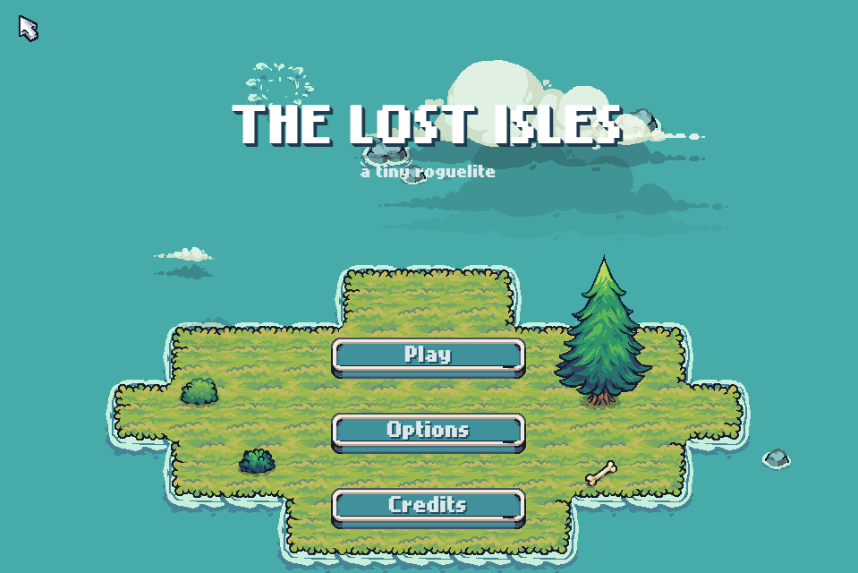
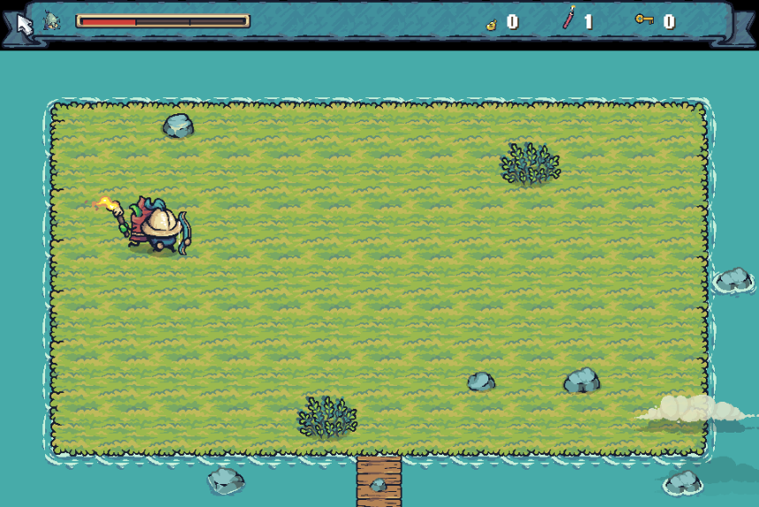
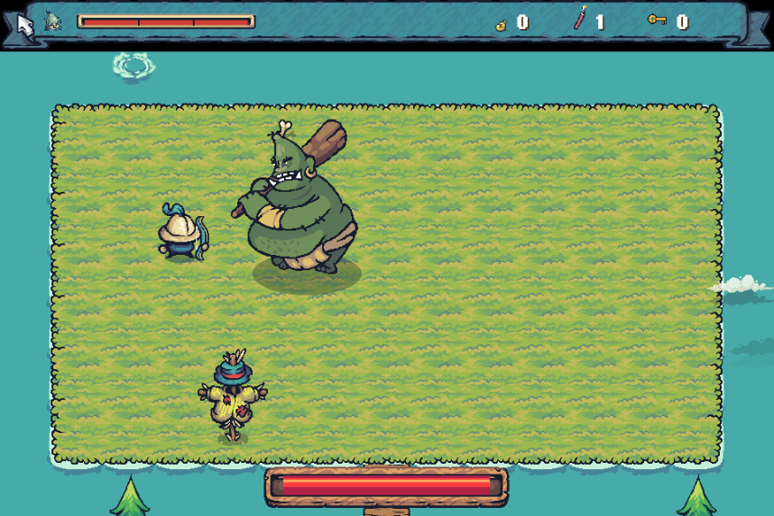

# The Lost Isles

*A tiny roguelite.* Pick a hero, sail from island to island, clear rooms, stack items into a build and take down the boss of each floor. Inspired by The Binding of Isaac, set on Tiny Swords islands.

### ▶ [Play it in your browser](https://hfarid19.github.io/the-lost-isles/)

Works best in desktop Chrome or Firefox with a keyboard and mouse (gamepads are wired up but untested). The first load takes a little while because all the sound effects are downloaded up front.

<p align="center">
  
  
  
</p>

## How to play

| Action | Keys |
|--------|------|
| Move | WASD |
| Aim and attack | Arrow keys or mouse |
| Bomb | E |
| Use item | Space |
| Block (Knight) / roll (Panda) | Shift |
| Map | Hold Tab |
| Pause | Escape |

Keys open shops. Lean on a hidden wall for 3 seconds to open a secret room. Every boss drops an item. Beat the Keep to unlock new islands.

## Features

- **Five heroes:** Archer, Knight, Lancer, Monk and Panda. Each has its own weapon and trait, and all but the Archer unlock through play.
- **Procedural floors:** every run lays out rooms and a floor map differently, with treasure rooms, shops and secret rooms.
- **Items that stack:** 20 pool items plus boss drops, combining into a build each run.
- **Nine levels and 24 bosses:** Plains, Forest, Goblin Camp and Caves lead to the final Keep, and there are unlockable islands: the Mystic Bamboo Isle, Shark Waters, Troy and the Gnome Mines.
- **Weather:** outdoor floors roll clear, rain or storm, with matching ambience.
- **Juice:** dynamic lighting, clouds, water splashes, screen shake and per-hit sound variation.
- **Three save slots** with their own unlocks and a mid-run checkpoint, an options menu, and a dev console opened with the backtick key.

The full design doc is in [DESIGN.md](DESIGN.md), and the sound catalogue is in [SOUNDS.md](SOUNDS.md).

## Code layout

```
source/
  Main.hx          entry point
  states/          menus, character select, sailing, the main PlayState
  entities/        player, enemies, bosses, props
  combat/          weapons (bow, sword, spear, fists, paws)
  items/           item pool and effects
  world/           floor generation and the floor map
  fx/              lighting, weather, clouds, splashes, sound
  ui/              HUD, menus, item cards, dev console
tools/             room generator (ASCII templates -> LDtk) and a headless-Chrome test driver
retired/source/    enemies that were cut
```

## Building

The game is written in [Haxe](https://haxe.org) with [HaxeFlixel](https://haxeflixel.com).

```sh
haxelib install lime 8.3.2
haxelib install openfl 9.5.2
haxelib install flixel 6.2.0
haxelib install flixel-addons 4.0.1

haxelib run lime test html5     # browser
haxelib run lime test mac       # native macOS
```

**This repo does not include the art, sound or music.** They come from paid or licensed asset packs whose licences allow using them in a game but not redistributing the files. To build it yourself, get the packs listed below and place the game-ready files in `assets/` (`images/`, `sounds/`, `music/` and `levels/`).

## Credits

- **Art:** [Tiny Swords](https://pixelfrog-assets.itch.io/tiny-swords) by Pixel Frog (Free Pack, Update 010 and Enemy Pack)
- **Item icons:** Admurin's Premium item packs
- **Sound:** Free Fantasy SFX Pack by TomMusic; FilmCow Recorded and Designed SFX
- **Music:** Pirate Music Pack Vol. 2 by alkakrab
- **Room layouts:** adapted from *The Binding of Isaac: Rebirth* (Nicalis / Edmund McMillen)
- Made with HaxeFlixel
